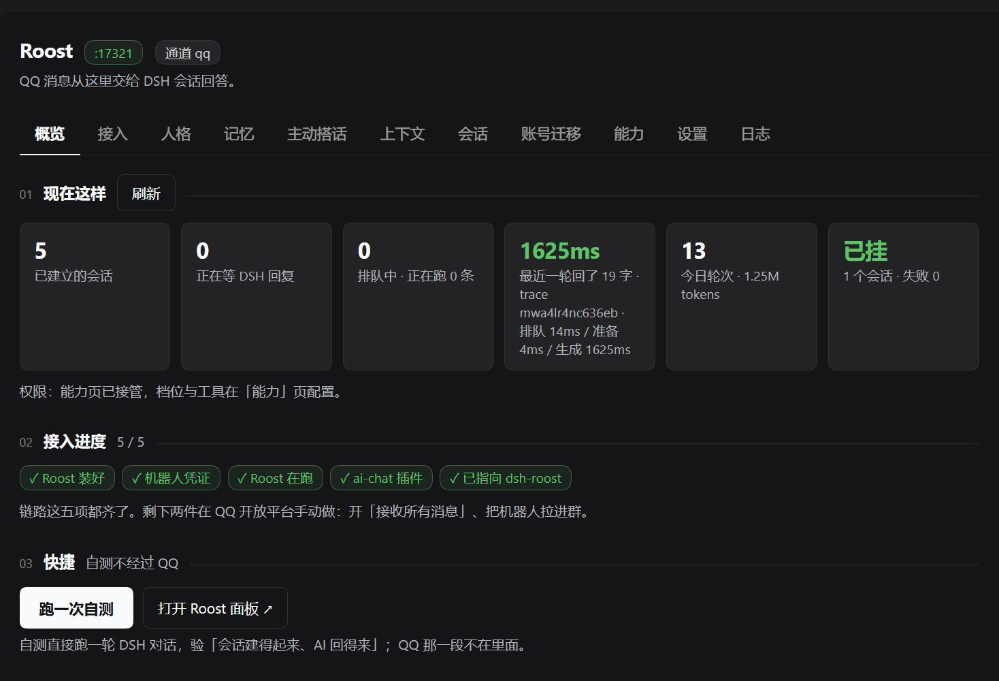

<div align="center">

# dsh-roost

> 给 QQ 机器人接上 DSH 的全部能力：工具、记忆、上下文压缩、主动搭话。

[](https://www.npmjs.com/package/dsh-roost) [](https://www.npmjs.com/package/dsh-roost) [](https://github.com/tdcq9594/dsh-roost/actions/workflows/ci.yml) [](https://github.com/tdcq9594/dsh-roost) [](https://github.com/topics/dsh-plugin) [](#) [](LICENSE)

**零依赖，装在 DSH 里**：权限、记忆、人格、扩展、排期都在侧栏面板里点着配。

[快速开始](#快速开始) ｜ [使用手册](docs/USER-MANUAL.md) ｜ [常见问题](#常见问题) ｜ [文档](#文档) ｜ [贡献](https://github.com/tdcq9594/dsh-roost/blob/main/CONTRIBUTING.md)

</div>

| 🛡️ 官方接口，不碰风控                  | 🎚️ 逐条权限，不整群一刀切     | 🧠 三层记忆，跨重启不丢         | 🔌 七步一键接入                 |
| ------------------------------ | ------------------- | --------------------- | ------------------------- |
| 走 QQ 开放平台 + ai-chat，不 hook 客户端 | 每句先判身份再收工具，认不出一律最低档 | 事实 / 日记 / 知识图谱，凌晨自动巩固 | Roost 本体、ai-chat、适配器配置自动装 |



> **侧栏「概览」页**：最上面是接入进度与一键启动，接着是六格状态（托管会话 / 今日 Token / 排队并发 / 缓存命中 / 最近一轮 / 工具挂载）、近 7 天用量、8 周活跃度、Token 构成与耗时拆分、会话卡片与筛选，最后是快捷、端口与最近动态。所有用量只统计 dsh-roost 自己创建的会话。换图要求见 [docs/images/README.md](docs/images/README.md)。

---

## 它做什么

给每个 QQ 会话建一个长期存在的 DSH 会话——一个群、一个私聊各对应一个，断线重连、重启之后映射还在。之后的每一轮：

1. **认人**：判断这句话是谁说的，按档位收好这一轮能用的工具
2. **交给 DSH**：把消息送进对应会话，等 AI 说完；工具、记忆、上下文压缩、人格都由 DSH 提供
3. **送回去**：按 ai-chat 给的地址回话，分几段说、配图、发语音、要不要收尾，都由模型自己调工具决定

能力从哪来，一眼看清：

| 你要的能力                                         | 由谁提供                                                                                                                  |
| --------------------------------------------- | --------------------------------------------------------------------------------------------------------------------- |
| 收发 QQ 消息、语音 ASR、引用 / 合并转发、切段、防吵（冷却 / 配额 / 认领） | [ai-chat](https://github.com/tdcq9594/qq-bot-roost-plugins) 插件 + [Roost](https://github.com/tdcq9594/qq-bot-roost) 框架 |
| 会话、工具（文件 / 命令）、三层记忆、上下文压缩、人格                  | DSH                                                                                                                   |
| 会话映射、逐条权限、侧栏面板、一键接入、主动搭话与排期                  | **dsh-roost**                                                                                                         |

**为什么值得接**：ai-chat 直连模型时，AI 只有「聊天」这一件事。挂到 DSH 上之后，它能用 DSH 的工具（文件、命令）、三层记忆、上下文压缩——这是 `adapter: dsh` 唯一的价值，也是它比直连贵的地方。

<details>

<summary>数据怎么走（链路图）</summary>

```
QQ ⇄ Roost 内核 ⇄ ai-chat 插件 ⇄ POST /inbound ⇄ dsh-roost ⇄ DSH 会话 ⇄ DeepSeek
                               ⇄ POST /reply  ⇄
```

`/inbound` 的请求形状、回复契约和鉴权见 [接入说明](docs/接入说明.md)。

</details>

只支持 QQ；通道抽象已备好，但还没接第二个平台。需要多平台可以看 [AstrBot](https://github.com/AstrBotDevs/AstrBot) 或 [Koishi](https://github.com/koishijs/koishi)。

---

## 特性

| 能力                       | 一句话                                                                                                       |
| ------------------------ | --------------------------------------------------------------------------------------------------------- |
| 🗨️ 一个 QQ 会话 = 一个 DSH 会话 | 映射存盘，断线重连、重启之后会话不丢                                                                                        |
| 🧭 一键接入                  | 七步向导 + 「一键就绪」，Roost 本体、ai-chat 插件、适配器配置都能自动装                                                              |
| 🔐 逐条权限判定                | 每一句都告诉 AI「谁在说、什么档位」，并按档位收本地工具                                                                             |
| 🧠 三层记忆                  | 跨群 / 本群事实 + 日记（三级衰减 + 关键词 / 向量检索）+ 知识图谱                                                                   |
| 🛠️ 记忆工具                 | `memory_search` / `memory_note`，让模型主动翻旧账                                                                  |
| 🌙 凌晨巩固                  | 打分、升降级、到期压缩、抽三元组、提取约定，不花白天的额度                                                                             |
| 🌅 觉醒                    | 约定 / 想你 / 随性三类机会打分，到点「问她要不要说」，不是硬发                                                                        |
| 💬 对话收尾                  | 记一句「收在哪 / 下次怎么接」，不发言、不动记忆；刚说完晚安 90 分钟内不重复冒出                                                               |
| 🗣️ 发言走工具                | `qq_send` / `qq_close` 由模型自己调，**调几次就是几条独立消息**，不是一段文本被动切段                                                  |
| 📎 能发文件                  | `qq_send_file`，可选路径白名单；发之前先问对面支不支持，一轮一个、200MB 上限、超 5MB 自动分片                                               |
| 📣 能 @ 人                 | `at` 参数；`[昵称 (openid)]` 由宿主拼，模型不碰 id 语法，降级时会告诉它为什么                                                        |
| 🗜️ 上下文压缩                | 群 85% / 私聊 75% 时开新会话 + 摘要开场，压缩前的缓存命中率记进面板                                                                 |
| 📱 侧栏面板                  | 八页：概览、排障、人格、记忆、主动搭话、权限、扩展、设置都在 DSH 里看；接入与账号迁移从按钮打开                                                   |
| 🧬 人格四段式                 | 性格 / 开场白 / 说话示例 / 世界书；世界书命中才注入，聊几十轮人设也不被冲淡                                                                |
| 🔄 人格库一键更新               | 独立仓库 [dsh-roost-personas](https://github.com/tdcq9594/dsh-roost-personas) 推个 commit，面板点一下就拿到，不用发版；只覆盖没改过的 |
| ⬆️ 本体自更新                 | 设置页查最新版一键装，失败回滚 `package.json` + lock；符号链接装的开发机自动禁用                                                       |
| 🧩 扩展 + 可调设置             | 扩展是标准 MCP server；在 `plugin.json` 声明字段后，面板直接按声明画表单，值宿主代存、密钥单独存且不回显，改完重启生效                        |
| 🎭 双人格 preset            | 私聊 `roost-private` / 群聊 `roost-social` 各一套提示词                                                             |
| 🖼️ 表情包                  | 图丢进目录就能用，文件名或侧车 `.tags` 当标签；分类 + `sticker_pick` 按需取图，加图不冲提示词缓存                                            |
| 🔊 语音合成（选装，默认关）          | 五种 provider，`tts.speed` 一份共用；不配就完全静默，配好模型才能用 `<<say: 内容>>`                                                |
| 🔑 账号迁移                  | 把 QQ号 / 群号和 openid 对上，换 AppID 后旧记忆照样读得到；绑定完全自愿、非必需                                                        |

20 条特性的完整说明、配置全文、五种语音 provider 的字段、表情包侧车语法、账号改写备份路径、面板明细等，全部在 **[使用手册](docs/USER-MANUAL.md)**（[特性逐条说明](docs/USER-MANUAL.md#特性逐条说明)）。

---

## 快速开始

**你需要**：DSH 桌面版 / Web 组合（要有 `sessionController` 和 `agents`）、Node 22+、一个 QQ 开放平台机器人（AppID / AppSecret）。Roost 和 ai-chat 不用提前准备 —— 接入流程里会装。

### 1. 装插件

DSH 插件市场里输入包名 `dsh-roost`，或命令行：

```bash
dsh plugin --profile web add dsh-roost
```

从源码装也行：`git clone https://github.com/tdcq9594/dsh-roost.git`（零依赖，不用 `npm install`）。

### 2. 找到入口

装好后在 **DSH 侧栏「Roost → 接入」**，是一条七步路径，能自动的都自动做掉：

| 步 | 做什么                         | 自动？                         |
| - | --------------------------- | --------------------------- |
| 1 | 装 Roost（下载解压，零依赖）           | ✅ 点一下 · 已装过可点「已装过？」填路径绑定    |
| 2 | 启动 Roost                    | ✅ 点一下（没填凭据也能起，正好用来扫码）       |
| 3 | 扫码 / 填 AppID、AppSecret      | ✋ 开放平台拿；存完自动重启 Roost 让新凭据生效 |
| 4 | 装 ai-chat 插件（走 Roost 的市场）   | ✅ 点一下                       |
| 5 | 把 ai-chat 切成 DSH 适配器，填好回话地址 | ✅ 点一下                       |
| 6 | 去群里说句话                      | ✋ 开放平台开「接收所有消息」+ 机器人进群      |
| 7 | 配置主人                        | ✅ 点一下，直接跳到 Roost 面板的「主人与群组」 |

顶上的「**一键就绪**」把 1、2、4、5 连着做完，卡在 3 就停下来提示你扫码或填。每一步也能单独点，跳着点不会把东西搞坏（每步先检测前置条件）。第 2 步「启动」之后，旁边按钮直接**打开 Roost 的 WebUI**（带上面板密钥）。

**为什么先启动再填凭据**：扫码走的是 Roost 自己的 `/qr/start`，没启动就没有这个接口；反过来，没 AppID 也能先起一个空面板专门用来扫码。这个顺序以前是反的，两边互相等死。

**下载地址**：优先 GitHub Release（自动补 `v` 前缀、自动查最新版），拿不到就回退 npm 包。**装到哪**：默认 `~/.dsh/dsh-roost/roost`，可在设置里改 `setup.roostDir`。

### 3. 升级

面板「设置」页顶部就是**更新**：本体和人格库都能查最新版、一键装。本体走 DSH 自己的 `pluginManager`，装完提示重启；人格库更新不用发版。开发机（符号链接装的）会自动禁用自更新。

> 装完没回话？先看 [常见问题](#常见问题) 里「两边地址和密钥要对上」那一条。

---

## 安全与隐私

| 关注点             | 实际情况                                                                                                                                                         |
| --------------- | ------------------------------------------------------------------------------------------------------------------------------------------------------------ |
| **不是插件沙箱**      | 权限层约束的是「AI 这一轮能调哪些工具」，不是「插件代码能做什么」。dsh-roost 作为 DSH 插件运行在你的账户下，拥有与本机同等的文件、命令和网络权限。真要隔离只能靠外部进程 + 系统级沙箱，本项目没有做。详见 [手册 · 权限](docs/USER-MANUAL.md#权限ai-知道是谁在说话)。 |
| **数据都在本机**      | 配置、记忆、日记、图谱、人格、表情包默认在 `~/.dsh/dsh-roost/`，可用 `DSH_ROOST_DATA` 改目录；不上传、不共享。备份 zip 也只写到你自己指定的位置。                                                               |
| **绑定 QQ 号完全自愿** | QQ 官方接口不提供 QQ号 / 群号，本项目不会获取、推算或抓取；号码只来自本人主动提供。不绑定不影响任何功能，昵称候选只提示不自动绑。详见 [手册 · 账号迁移](docs/USER-MANUAL.md#账号迁移v100)。                                           |
| **语音会发文本给谁**    | 本地 `sherpa` 完全离线；微软 `edge` 会把要念的文本发到微软服务器；OpenAI 兼容 / 小米 MiMo 发给你自己填的上游。不配 TTS 就完全静默。                                                                        |
| **密钥**          | `server.token` 只在本机同步到 ai-chat 的「共享密钥」，别贴进 issue 或截图。                                                                                                        |

---

## 文档

| 文档                                                                      | 内容                                                    |
| ----------------------------------------------------------------------- | ----------------------------------------------------- |
| [使用手册](docs/USER-MANUAL.md)                                             | 配置全文、五种语音 provider、权限页、面板明细、账号迁移、备份、表情包、目录结构、开发测试 |
| [接入说明](docs/接入说明.md)                                                    | 宿主协议两端：`/inbound` 请求形状、回复契约，排查「为什么没回话」                |
| [能力页方案](docs/能力页方案.md)                                                  | 五档栈式继承、分群覆盖、功能开关与次数配额的设计                              |
| [排队方案](docs/排队方案.md)                                                    | 同一会话并发轮次怎么排                                           |
| [TTS 与翻唱调研](docs/TTS与翻唱调研.md)                                           | 语音 provider 选型与字段来源                                   |
| [与 Aurabot 对比](docs/与Aurabot对比.md)                                      | 传输层、会话模型、能力边界的逐项对照                                    |
| [扩展机制方案](docs/扩展机制方案.md)                                                | 扩展机制的设计与实测记录（v1.1.0 起已落地，实现细节以源码为准）                       |
| [参与贡献](https://github.com/tdcq9594/dsh-roost/blob/main/CONTRIBUTING.md) | 本地跑起来、PR 前五步检查、代码约定                                   |

`docs/` 下还有人格市场、人格名全局化、会话查询工具、更新中心、端口自动切换、DSH 分支等设计文档与调研，按主题索引上面这几份即可。

---

## 常见问题


<details>

<summary>装好了但一句都不回 / 全部 401</summary>

九成是**两边的地址和密钥没对上**：ai-chat 的「DSH 地址」要等于 `http://127.0.0.1:<server.port>`；`server.token` 非空时，dsh-roost 会把它同步到 ai-chat 的「共享密钥」，不同步的话 `/inbound`、`/capabilities`、`/tts` 全是 401，而两边都不会主动说「密钥不对」。端口被占用时会自动换（`lease.js`），以启动日志和面板为准，**不是固定 17321**。详见 [手册 · 配置](docs/USER-MANUAL.md#配置)。

</details>

<details>

<summary>「逐条权限」是不是把插件关进沙箱了</summary>

不是。它只约束「AI 这一轮能调哪些工具」，插件代码本身运行在你账户下，拥有与本机同等的文件、命令和网络权限。见 [安全与隐私](#安全与隐私)。

</details>

<details>

DeepSeek 抽风 / 502 了怎么办

**模型服务挂了插件救不了**。网关 502 时补重试能救回一部分，整体挂掉只能等它恢复；这种时候插件回一句「模型服务那边暂时抽风了」，不会把内部报错糊给你。可以先点面板「概览」里的**跑一次自测**——它不经过 QQ，直接跑一轮 DSH 对话，能区分是「会话建不起来」还是「QQ 那半边没通」。


</details>

<details>

<summary>表情包发出去为什么不是收藏表情</summary>

是**普通图片消息**，对方收到的是图，不会进他的「表情」收藏夹——协议层的限制，插件改不了。另外超过 20MB 会被降级成**文件**发送。详见 [手册 · 表情包](docs/USER-MANUAL.md#表情包)。

</details>

<details>

<summary>不绑定 QQ 号 / 群号会有影响吗</summary>

完全没有影响。官方只给 `openid`，本项目不会猜、不会抓；绑定只为换 AppID 之后还能读到旧记忆，且任何绑定都可随时解绑。详见 [手册 · 账号迁移](docs/USER-MANUAL.md#账号迁移v100)。

</details>

<details>

<summary>语音要钱 / 要 API Key 吗</summary>

本地 `sherpa` 和微软 `edge` 都不用 Key（前者完全离线，后者把文本发到微软服务器）；OpenAI 兼容和 GPT-SoVITS 用你自己的服务；小米 MiMo 需要一个 API Key。默认 `tts.enabled: false`，不配就完全静默。详见 [手册 · 配置](docs/USER-MANUAL.md#配置)。

</details>

<details>

<summary>装不上 / 七步卡住了看哪</summary>

第 3 步的 AppID / AppSecret 要去 QQ 开放平台拿，第 6 步要开「接收所有消息」并让机器人进群——这两步是手动的。其余步骤都能单点点，跳着点不会搞坏（每步先检测前置条件）。下载优先 GitHub Release，拿不到才回退 npm 包。日志在面板「排障」页，按级别筛。

</details>

<details>

<summary>怎么升级 / 换电脑</summary>

升级走面板「设置」顶部「更新」；换电脑用 `node scripts/backup.mjs export` 打一个 zip，新机器 `import` 后**下次启动**才换上，可以 `cancel` 反悔。详见 [手册 · 一键备份](docs/USER-MANUAL.md#一键备份换电脑)。

</details>

---

## 参与贡献

欢迎提 issue、改文档、修 bug。本地怎么跑、PR 前要过哪五步检查、代码约定，都写在 **[CONTRIBUTING.md](https://github.com/tdcq9594/dsh-roost/blob/main/CONTRIBUTING.md)**。

---

## 致谢

角色设计参考了 [Aurabot（dsh-aurabot-qq）](https://github.com/aureth-labs/dsh-aurabot-qq)：一个 QQ 会话对一个 DSH 会话、人格独占系统提示词、安全默认、按会话挂东西、用 `agent.followup` + `sessions.flush` 投递、从 `session/event` 取回复。这些思路让我们少走了不少弯路，在此致谢。

QQ 侧依托自家的 [栖 Roost](https://github.com/tdcq9594/qq-bot-roost) 与 [ai-chat 插件](https://github.com/tdcq9594/qq-bot-roost-plugins)；许可也沿用 Roost 的 AGPL-3.0-only。

---

## 和 Aurabot 的对比

**传输层完全不同**：Aurabot 走 OneBot（SnowLuma，hook 本机 QQ 客户端），这里走 ai-chat 插件（Roost 官方接口）。所以 Aurabot 里那批 OneBot 特有的东西（数字 QQ 号、base64 语音段）这里一个都不需要。

一句话：**传输层我们更稳（官方接口），对话体验它更成熟。** 只想用现成的，先去试试 Aurabot。逐项对照见 [与 Aurabot 对比](docs/与Aurabot对比.md)。

---

## 已知限制

- 只支持 QQ（`channel.current = 'qq'`），通道抽象已备好但还没接第二个平台
- 语音靠官方 ASR（`asr_refer_text`），没有本地语音模型；TTS 音色由 ai-chat 设置，面板只读
- 面板的配置正文仍是 JSON 直编辑（不是逐字段表单），代价是要看得懂结构——所以配了分节说明；「权限」页那批（档位、功能开关、次数限制、分群例外）已经是可点的
- **模型服务挂了插件救不了**：网关整体挂掉时只能等它自己恢复
- 表情包发出去是**普通图片消息**，不是 QQ 收藏表情（协议层限制）
- **排队只存内存**：进程重启时正在排的那条会丢；面板暂时看不到队列长度（`stats()` 已备好）
- **巩固不进队列**：`memory.consolidateChat` 配成私聊 openid 时，撞上正在跑的一轮仍会失败（次日补跑）

---

<details>

<summary>旧版 README 的章节导航（链接保留，内容已迁到使用手册）</summary>

### 配置

见 [使用手册 · 配置](docs/USER-MANUAL.md#配置)（含五种语音 provider 的全部字段）。

### 权限：AI 知道是谁在说话

见 [使用手册 · 权限](docs/USER-MANUAL.md#权限ai-知道是谁在说话)。

### 面板

见 [使用手册 · 面板](docs/USER-MANUAL.md#面板)。

### 账号迁移（v1.0.0）

见 [使用手册 · 账号迁移](docs/USER-MANUAL.md#账号迁移v100)。

### 一键备份（换电脑）

见 [使用手册 · 一键备份](docs/USER-MANUAL.md#一键备份换电脑)。

### 表情包

见 [使用手册 · 表情包](docs/USER-MANUAL.md#表情包)。

### 目录结构

见 [使用手册 · 目录结构](docs/USER-MANUAL.md#目录结构)。

### 开发与测试

见 [使用手册 · 开发与测试](docs/USER-MANUAL.md#开发与测试) 与 [CONTRIBUTING.md](https://github.com/tdcq9594/dsh-roost/blob/main/CONTRIBUTING.md)。

</details>

---

## 许可

沿用 [Roost](https://github.com/tdcq9594/qq-bot-roost) 的许可：**GNU Affero General Public License v3.0 only（AGPL-3.0-only）**。允许商业使用与收费分发，但分发或通过网络提供服务时必须同样以 AGPL-3.0-only 开源并提供完整对应源码。全文见 [LICENSE](LICENSE)。
